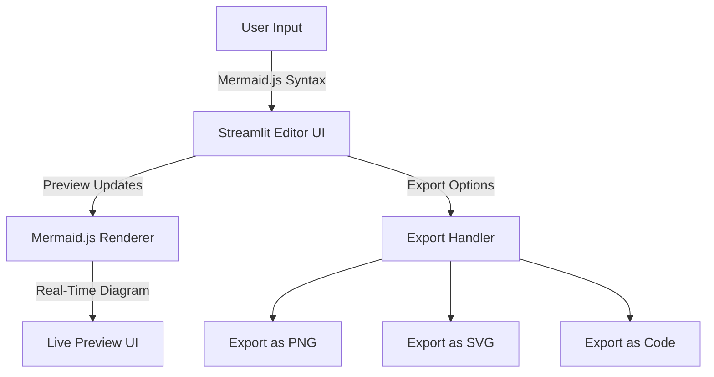

# Mermaid Editor     

## Executive Summary
**Mermaid Editor** is an interactive diagram creation tool that empowers users to design, edit, and render powerful Mermaid.js diagrams in real time. Built with Python, Streamlit, and Mermaid.js, it streamlines the visualization process for software engineers, product managers, and cross-functional teams. This tool reduces the effort required for creating diagrams while enhancing collaborative productivity.

---

## Key Features
- **Interactive Diagram Builder**: Create and visualize flowcharts, sequence diagrams, Gantt charts, and more using the intuitive Mermaid.js syntax.
- **Live Preview**: Real-time updates of diagrams as you write or modify Mermaid.js code, eliminating the need for external rendering tools.
- **Multiple Export Formats**: Save diagrams as PNG, SVG, and raw Mermaid.js code for seamless application in your projects.
- **Streamlit-Powered UI**: A clean, responsive interface for designing and previewing diagrams with no prior setup required.
- **Collaborative Features** (In Progress): Support for comments and planned real-time editing capabilities to foster teamwork and ideation.
- **Robust Documentation**: Step-by-step user guides explaining use cases, integrations, and supported diagram types.
- **Extensible Backend**: Modular Python architecture designed to integrate with APIs or custom data pipelines.

---

## Architecture & Workflow
Mermaid Editor utilizes a lightweight Python and Streamlit backend to interface with Mermaid.js visualization capabilities. Below is a high-level overview of the system architecture and interaction flow:



---

## Tech Stack & Tools
- **Python**: Backend logic, file handling, and seamless integration with Streamlit.
- **Streamlit**: Lightweight and user-friendly frontend library for building web applications.
- **Mermaid.js**: Diagrams-as-code framework for rendering flowcharts, sequence diagrams, and more.
- **Docker** (Optional): For containerization and deployment in enterprise environments.

---

## Quickstart / Installation
Follow the steps below to set up and run the Mermaid Editor locally:

1. **Clone the Repository**:
   ```bash
   git clone https://github.com/EF361/mermaid_editor.git
   cd mermaid_editor
   ```

2. **Create a Virtual Environment**:
   ```bash
   python3 -m venv venv
   source venv/bin/activate   # On Windows, use `venv\Scripts\activate`
   ```

3. **Install Dependencies**:
   ```bash
   pip install -r requirements.txt
   ```

4. **Run the Application**:
   ```bash
   streamlit run app.py
   ```

5. **Access the Editor**:
   Navigate to `http://localhost:8501` in your browser.

6. **Optional - Docker Deployment**:
   Build and run the application in a Docker container:
   ```bash
   docker build -t mermaid-editor .
   docker run -p 8501:8501 mermaid-editor
   ```

---

## Feedback and Contributions
Collaborative features such as comments and real-time editing are actively in progress. We welcome your feedback and ideas! If you'd like to contribute, please check the [Contributing Guide](CONTRIBUTING.md) or open an issue.

---

> Developed by **Alicia Goh** *(EF361)* - Senior AI & Software Engineer.