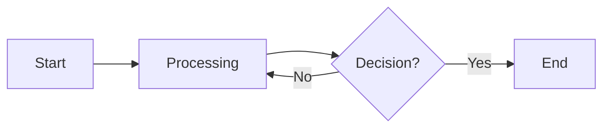
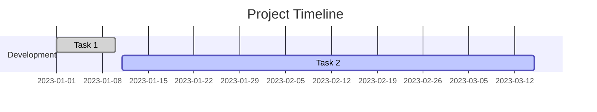

# Mermaid Editor


## Executive Summary 🌟

**Mermaid Editor** is a lightweight, Streamlit-powered visualization tool that enables users to create, preview, and export beautiful diagrams using **Mermaid.js**. It simplifies the process of turning plain-text diagram definitions into professional visuals, with a focus on usability, extensibility, and performance.

---

## Key Features 🔑

- **Live Rendering**: Real-time preview of Mermaid diagrams as you type.
- **Export to PNG/SVG**: Generate and download high-quality diagrams with accurate dimensions, fonts, and backgrounds.
- **Input Sandbox**: Securely processes Mermaid code with input sanitization to mitigate script-injection risks.
- **Theme Support**: Toggle between Mermaid themes (`default`, `dark`, `forest`, etc.).
- **Validation Feedback**: Highlights invalid Mermaid syntax errors for faster debugging.
- **Lightweight Docker Support**: Optional containerized deployment for seamless setup.
- **Responsive Design**: Optimized for both desktop and mobile environments.
- **Extendable Implementation**: Ready for future collaboration and real-time editing features.

---

## Architecture & Workflow 🏗️

The **Mermaid Editor** workflow integrates Python and Javascript execution seamlessly, bridging Streamlit for UI handling and Mermaid.js for diagram rendering in the browser. Below is the high-level architecture:

```mermaid
graph TD
    User[User Input] -->|Text-based Diagram Code| Streamlit[Streamlit Backend]
    Streamlit -->|Validate and Sanitize Input| MermaidJS[Mermaid.js Render Engine]
    MermaidJS -->|Live Diagram Rendering| Browser[Frontend]
    Browser -->|Export Request (PNG/SVG)| Streamlit[Streamlit Backend]
    Streamlit --> Storage[File System]
```

---

## Tech Stack & Tools 🛠️

- **Frontend**: Streamlit for UI rendering and layout.
- **Diagram Engine**: Mermaid.js (v10.x) for diagram generation.
- **Backend**: Python 3.9+, with strict sandboxing of user inputs.
- **Security**: Content Security Policy (CSP) to prevent script injection.
- **Optional Deployment**: Docker for isolated application runtime.

---

## Quickstart / Installation 🚀

Follow these instructions to set up and deploy the Mermaid Editor locally or in a containerized environment:

### Prerequisites
- Python 3.9 or higher
- Node.js for serving Mermaid.js assets (optional)
- Docker (if deploying via container)

### Local Installation

```bash
# Clone the repository
git clone https://github.com/EF361/mermaid_editor.git
cd mermaid_editor

# Create a virtual environment
python -m venv .venv
source .venv/bin/activate    # On Windows, use .venv\Scripts\activate

# Install dependencies
pip install -r requirements.txt

# Run the Streamlit app
streamlit run app.py
```

### Docker Deployment

```bash
# Build the Docker image
docker build -t mermaid_editor .

# Run the container
docker run -d -p 8501:8501 mermaid_editor
```

Visit `http://localhost:8501` in your browser to start using the **Mermaid Editor**.

---

## Verified Screenshots & Examples 📸

Here are some examples of the diagrams you can create with Mermaid Editor:

**Flowchart Example**



**Gantt Chart Example**



---

## Roadmap 🚧

This repository is a foundational implementation and will expand with future updates:
- 🌐 **Collaboration**: Real-time editing and multi-user support.
- 🔗 **Integrations**: Embed diagrams in Markdown or Confluence natively.
- 🛠 **Custom Extensions**: Add hooks for new diagram types or themes.

---

## Contribution Guidelines 🤝

Contributions are welcome! Please refer to the [`CONTRIBUTING.md`](CONTRIBUTING.md) file for details on the development workflow and coding standards.

---

## License 📜

This project is licensed under the **MIT License**. See the [LICENSE](LICENSE) file for details.

---

**Crafted with ❤️ by [Alicia Goh (EF361)](https://github.com/EF361)**