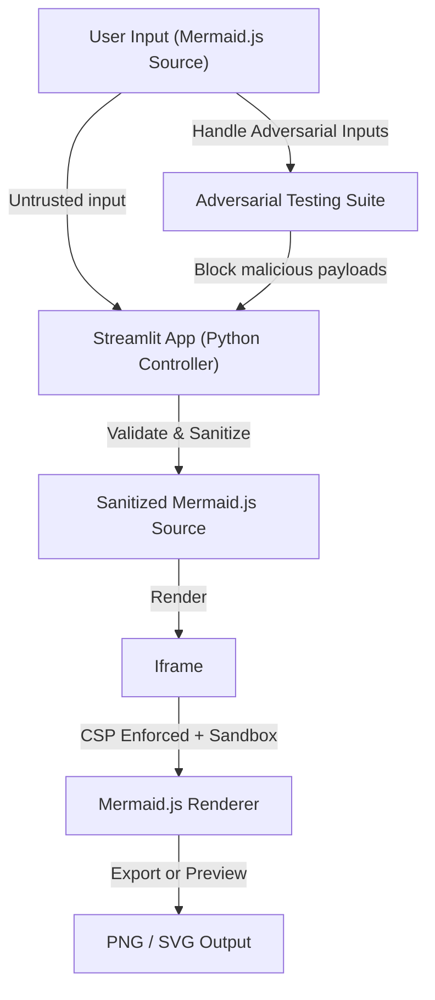

# Mermaid Editor [](https://www.python.org/) [](https://streamlit.io/) [](https://mermaid-js.github.io/mermaid/) [](LICENSE)

## Executive Summary
**Mermaid Editor** is a secure, interactive diagramming tool that leverages **Mermaid.js** and **Streamlit** to enable the rapid creation, visualization, and safe export of diagrams directly in your browser. It introduces airtight security measures through iframe sandboxing, rigorous Content Security Policies (CSP), and adversarial test validations to ensure that all diagram inputs are isolated and rendered safely.

---

## Key Features
- **Interactive Diagram Editor**: Create and preview flowcharts, sequence diagrams, and more in real time with **Mermaid.js 10**.
- **Security-First Design**:
  - Strict **iframe sandboxing** to isolate rendering.
  - Enforced **Content Security Policies** to block external network requests and scripts.
  - Input sanitization and adversarial testing to handle untrusted diagram data.
- **Export Capabilities**:
  - Export diagrams as **PNG** or independently sanitized **SVG** files.
  - Secure processing to prevent injection risks in exported files.
- **Robust Local Asset Management**:
  - Mermaid.js assets are pinned to exact versions.
  - Asset hashes verified in CI to prevent injection risks from upstream changes.
- **Adversarial Testing Suite**:
  - Includes tests for oversized diagrams, denial-of-service vectors, malicious scripts, and abusive event handlers.
- **Dockerized Development**:
  - Seamless setup with Docker ensures consistency across environments.

---

## Architecture & Workflow



- **Trust Boundary 1**: Between user input and the Python-backend controller, all input is treated as untrusted.
- **Trust Boundary 2**: Between the sanitized source and the `iframe`, the CSP-whitelisted sandbox prevents any unauthorized network requests, script execution, or navigation.
- **Export Workflow**: PNG/SVG exports are extracted via secure rendering and independently sanitized for injection attacks.

---

## Tech Stack & Tools Breakdown
- **Python 3.9+**: Powers the backend logic and input validation layer.
- **Streamlit**: Provides a responsive, browser-based interface for live diagram editing.
- **Mermaid.js 10**: The core rendering engine for all diagram types.
- **HTML `iframe` Sandboxing**: Ensures strict isolation and rendering security.
- **Content Security Policies (CSP)**: Restricts network, script, and redirect permissions.
- **Docker**: Facilitates consistent development and deployment environments.
- **pytest**: Powers the adversarial test suite for robustness and security validation.

---

## Quickstart / Installation

### Prerequisites
- Python 3.9+
- Docker (if running via container)

### Clone the Repository
```bash
git clone https://github.com/EF361/mermaid_editor.git
cd mermaid_editor
```

### Using Docker
Run the application in an isolated Docker container:
```bash
docker build -t mermaid_editor .
docker run -p 8501:8501 mermaid_editor
```

### Local Installation
Install dependencies and run the app locally:
```bash
pip install -r requirements.txt
streamlit run app.py
```

### Running the Tests
Execute the test suite to validate security and functionality:
```bash
pytest
```

---

## Reporting Issues
For bugs or security concerns, please [open an issue](https://github.com/EF361/mermaid_editor/issues).

---

## License
This project is licensed under the [MIT License](LICENSE).

**Crafted with precision by Alicia Goh (EF361).**