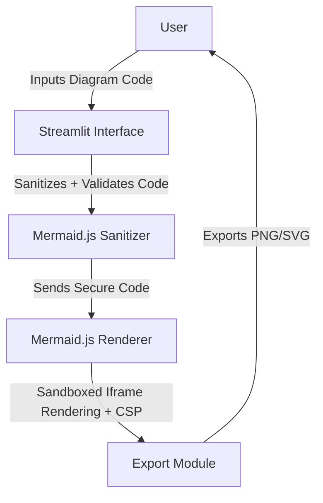

# Mermaid Editor - Interactive Diagram Editor for Developers and Teams


[](https://your-live-demo-link.com)

---

## Executive Summary

Mermaid Editor is an interactive, secure, and fully sandboxed editor for creating, validating, and exporting diagrams using Mermaid.js. Tailored for developers, teams, and technical writers, it empowers users to rapidly prototype visualization ideas while ensuring secure rendering and reproducible outputs across environments.

---

## Key Features

- **Live Diagram Rendering**: Instant feedback as you design your flowcharts, sequence diagrams, and more.
- **Advanced Security**: Enforces Mermaid's strict mode with a maintained sanitizer and sandboxed iframes protected by Content Security Policies (CSP).
- **Theme and Export Support**: Apply custom themes and export diagrams to scalable formats (SVG/PNG) ensuring consistency across fonts, viewports, and browsers.
- **Regression Testing**: Includes comprehensive tests for security vulnerabilities such as script injections, malformed syntax, and rendering edge cases.
- **Offline Asset Pinning**: Mermaid.js assets are pinned locally with subresource integrity (SRI) checks to ensure secure and reliable operation.
- **Zero Persistent Storage**: All operations avoid persistent filesystem usage, supporting stateless workflows.
- **Docker-Ready**: Fully containerized setup for environment-agnostic deployment.
- **Cross-Browser Consistency**: Deterministic rendering validated across popular browsers to maintain quality.

---

## Architecture & Workflow

The Mermaid Editor follows a modular workflow to ensure security and high reliability. Below is an architecture diagram to explain the interactions between components:



Workflow Summary:
1. The user provides Mermaid.js diagram code via the Streamlit-based UI.
2. Code is sanitized and validated using a maintained sanitizer aligned with Mermaid’s security guidelines.
3. Valid diagrams are rendered in a sandboxed iframe with strict CSPs (blocks scripts, unnecessary navigation, or network permissions).
4. The user can preview, theme, and export diagrams without affecting persistent storage.

---

## Tech Stack & Tools Breakdown

- **Frontend**: Streamlit for a lightweight, interactive interface.
- **Diagram Rendering**: Mermaid.js 10 for robust diagram generation with strict security mode enabled.
- **Packaged Deployment**: Docker for portable containerized environments.
- **Languages**: Python 3.9+ for backend processing.

---

## Quickstart / Installation

To get started with Mermaid Editor, follow these steps:

### Prerequisites
- Python 3.9+
- Docker (if using containerized setup)

### Installation

1. **Clone the repository**:
   ```bash
   git clone https://github.com/EF361/mermaid_editor.git
   cd mermaid_editor
   ```

2. **Using Python (Local Development)**:
   - Create a virtual environment:
     ```bash
     python3 -m venv venv
     source venv/bin/activate  # On Windows, use `venv\Scripts\activate`
     ```
   - Install dependencies:
     ```bash
     pip install -r requirements.txt
     ```
   - Run the app:
     ```bash
     streamlit run app.py
     ```

3. **Using Docker (For Production)**:
   - Build the Docker image:
     ```bash
     docker build -t mermaid_editor:latest .
     ```
   - Run the container:
     ```bash
     docker run -p 8501:8501 mermaid_editor:latest
     ```
   - Access the app at `http://localhost:8501`.

### Testing
Run the provided security and regression tests to ensure the app is functioning safely and reliably:
```bash
pytest tests/
```

---

## Contributing

We welcome contributions to enhance Mermaid Editor! Please see our [CONTRIBUTING.md](CONTRIBUTING.md) for guidelines.

---

## License

This project is licensed under the MIT License. See the [LICENSE](LICENSE) file for details.

---

## Live Demo

Explore a live demonstration of Mermaid Editor by visiting our [Live Demo](https://your-live-demo-link.com).

---

**Crafted by Alicia Goh (EF361)** 

Alicia is an accomplished AI & Software Engineer passionate about building secure, user-friendly tools for developers worldwide.